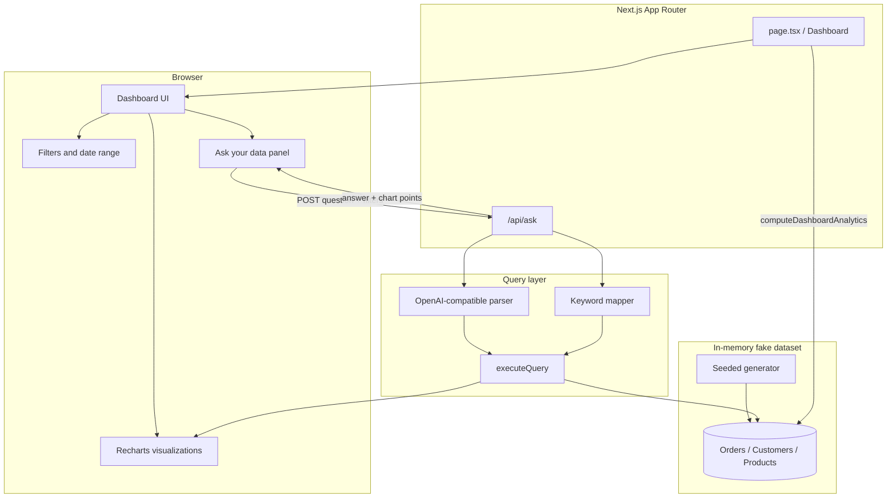

# AI Analytics Dashboard Demo

Portfolio-ready **Next.js (App Router, TypeScript, Tailwind)** dashboard over a **generated fake SaaS/e-commerce dataset**. Includes KPI cards, interactive filters, date range, five Recharts visualizations, and an **Ask your data** panel that maps natural language to structured queries (LLM when configured, deterministic keyword mapper otherwise).

> All metrics are synthetic. No real customer data. No secrets committed.

## Quick start

```bash
npm install
npm run dev
```

Open [http://localhost:3000](http://localhost:3000).

### Production build (Vercel-ready)

```bash
npm run build
npm run start
```

### Optional LLM provider

Copy `.env.example` to `.env.local` and set `OPENAI_API_KEY`. Without a key, `/api/ask` uses the built-in keyword mapper and works fully offline.

## Scripts

| Command | Description |
|---------|-------------|
| `npm run dev` | Local development server |
| `npm run build` | Production build |
| `npm test` | Unit tests (Vitest) |
| `npm run test:e2e` | Playwright smoke test |
| `npm run record:demo` | Record portfolio demo video |

## Architecture



## Project layout

- `src/lib/data/` — seeded fake dataset generation
- `src/lib/analytics/` — KPI and chart aggregations for the main dashboard
- `src/lib/query/` — structured query types, filters, executor, keyword mapper
- `src/lib/llm/` — provider interface (API key or fallback)
- `src/app/api/ask/` — natural-language analytics endpoint
- `src/components/` — dashboard UI, filters, ask panel, charts

## Tests

- **Unit:** query execution and keyword mapping (`vitest`)
- **E2E:** dashboard load and ask flow (`playwright`)

## License

MIT — portfolio demonstration only.
>>>>>>> 5a81c04 (Add AI analytics dashboard portfolio demo)
